<div align="center">

<!-- Animated SVGs in assets/ are generated by scripts/gen_assets.py -->


<!-- Badges: https://shields.io/ -->
[](https://github.com/colinlabs)
[](https://x.com/colinlabs)
[](#contact)


</div>

### 🧑‍💻 About me

I build and run cloud-native infrastructure end to end: Kubernetes platforms,
delivery pipelines, observability and the automation that ties them together.
I care about boring deployments, systems that explain themselves, and turning
manual runbooks into code.

- ☸️ **Kubernetes platforms** — cluster design, upgrades and day-2 operations
- 🚀 **CI/CD** — pipeline-as-code with Drone and Git, from commit to production
- 📈 **Observability** — metrics, logs and alerting with Prometheus, Grafana, Elastic and Fluentd
- 🧭 **Service discovery** — config and service mesh basics with Consul
- ☁️ **Cloud** — reliable, cost-aware infrastructure on Alibaba Cloud
- 🤖 **AI engineering** — LLM agents, MCP tooling and AI-assisted operations (AIOps)
- 🌱 **Currently** — writing Go tooling for Kubernetes
- 💬 Ask me about DevOps, SRE or cloud native, happy to help

### 🧰 Tech stack

<picture>
  <source media="(prefers-color-scheme: dark)" srcset="https://raw.githubusercontent.com/colinlabs/colinlabs/master/assets/stack-dark.svg" />
  
</picture>

### 📊 GitHub stats

<p align="center">
  <!-- Stats: https://github.com/anuraghazra/github-readme-stats -->
  <a href="https://github.com/colinlabs">
    <picture>
      <source media="(prefers-color-scheme: dark)" srcset="https://github-readme-stats.vercel.app/api?username=colinlabs&show_icons=true&hide_border=true&include_all_commits=true&hide=contribs&theme=github_dark" />
      
    </picture>
  </a>
  <!-- Streak: https://github.com/DenverCoder1/github-readme-streak-stats -->
  <a href="https://github.com/colinlabs">
    <picture>
      <source media="(prefers-color-scheme: dark)" srcset="https://streak-stats.demolab.com?user=colinlabs&hide_border=true&theme=github-dark-blue" />
      
    </picture>
  </a>
</p>

### 🐍 Contributions

<!-- Snake: generated daily by .github/workflows/snake.yml into the output branch -->
<picture>
  <source media="(prefers-color-scheme: dark)" srcset="https://raw.githubusercontent.com/colinlabs/colinlabs/output/github-snake-dark.svg" />
  
</picture>

<a name="contact"></a>
### 📫 Contact

```sh
echo Z2Vlay5jb2xpbkBnbWFpbC5jb20= | base64 -d
```

<!-- Footer wave: https://github.com/kyechan99/capsule-render -->

